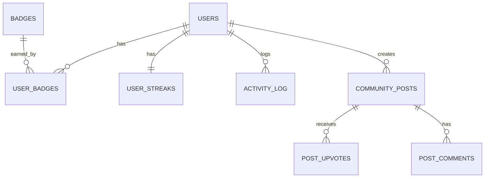

# PrepBridge Database Schema Documentation
## Your Part: Gamification, Community & Analytics Module

> **Division of Work:**
> - **Your Part (This Document):** Achievements/Gamification, Community, Reports/Analytics, Calendar/History
> - **Teammate's Part:** Users, Tasks, Companies/JD Matching, Roadmap, Profile

---

## 🎯 Overview

This document covers the database schema for the **Gamification, Community & Analytics** modules of PrepBridge. These tables handle user achievements, community interactions, progress analytics, and historical tracking.

---

## 📊 Entity Relationship Diagram (ERD) - Your Module

```
┌─────────────────────────────────────────────────────────────────────────────────────┐
│                           GAMIFICATION & COMMUNITY MODULE                            │
└─────────────────────────────────────────────────────────────────────────────────────┘

                    ┌────────────────────┐
                    │      USERS         │
                    │   (Reference)      │
                    └─────────┬──────────┘
                              │
          ┌───────────────────┼───────────────────┬─────────────────────┐
          │                   │                   │                     │
          ▼                   ▼                   ▼                     ▼
┌─────────────────┐  ┌─────────────────┐  ┌─────────────────┐  ┌─────────────────┐
│  USER_STREAKS   │  │ USER_BADGES     │  │ COMMUNITY_POSTS │  │ WEEKLY_REPORTS  │
│                 │  │                 │  │                 │  │                 │
│ - user_id (FK)  │  │ - user_id (FK)  │  │ - user_id (FK)  │  │ - user_id (FK)  │
│ - current_streak│  │ - badge_id (FK) │  │ - anonymous_id  │  │ - week_number   │
│ - longest_streak│  │ - earned_at     │  │ - content       │  │ - productivity  │
│ - last_active   │  │ - progress      │  │ - upvotes       │  │ - tasks_done    │
└────────┬────────┘  └────────┬────────┘  └────────┬────────┘  └────────┬────────┘
         │                    │                    │                    │
         │                    ▼                    ▼                    ▼
         │           ┌─────────────────┐  ┌─────────────────┐  ┌─────────────────┐
         │           │    BADGES       │  │ POST_COMMENTS   │  │  REFLECTIONS    │
         │           │                 │  │                 │  │                 │
         │           │ - id            │  │ - post_id (FK)  │  │ - user_id (FK)  │
         │           │ - name          │  │ - user_id (FK)  │  │ - went_well     │
         │           │ - description   │  │ - content       │  │ - challenges    │
         │           │ - category      │  │ - anonymous_id  │  │ - improvements  │
         │           │ - icon          │  │ - created_at    │  │ - mood          │
         │           │ - criteria      │  └─────────────────┘  └─────────────────┘
         │           └─────────────────┘
         │                                        │
         │                    ┌───────────────────┴───────────────────┐
         ▼                    │                                       │
┌─────────────────┐          ▼                                       ▼
│ ACTIVITY_LOG   │  ┌─────────────────┐               ┌─────────────────────────┐
│                │  │  POST_UPVOTES   │               │    POST_BOOKMARKS       │
│ - user_id (FK) │  │                 │               │                         │
│ - date         │  │ - post_id (FK)  │               │ - post_id (FK)          │
│ - tasks_count  │  │ - user_id (FK)  │               │ - user_id (FK)          │
│ - minutes_spent│  │ - created_at    │               │ - created_at            │
│ - productivity │  └─────────────────┘               └─────────────────────────┘
└─────────────────┘
                              │
                              ▼
                    ┌─────────────────┐
                    │  POST_REPORTS   │
                    │                 │
                    │ - post_id (FK)  │
                    │ - reporter_id   │
                    │ - reason        │
                    │ - status        │
                    └─────────────────┘
```

---

## 📋 Detailed Table Schemas

### 1. BADGES (Master Table)

Stores all available badges/achievements in the system.

```sql
CREATE TABLE badges (
    id              UUID PRIMARY KEY DEFAULT gen_random_uuid(),
    name            VARCHAR(100) NOT NULL UNIQUE,
    description     VARCHAR(500) NOT NULL,
    category        VARCHAR(50) NOT NULL CHECK (category IN ('consistency', 'progress', 'milestone', 'special')),
    icon            VARCHAR(10) NOT NULL,  -- Emoji or icon code
    criteria_type   VARCHAR(50) NOT NULL,  -- 'streak', 'task_count', 'roadmap_percent', 'upvotes', 'jd_score'
    criteria_value  INTEGER NOT NULL,      -- Target value to earn badge
    points          INTEGER DEFAULT 10,    -- Gamification points
    rarity          VARCHAR(20) DEFAULT 'common' CHECK (rarity IN ('common', 'rare', 'epic', 'legendary')),
    is_active       BOOLEAN DEFAULT true,
    created_at      TIMESTAMP DEFAULT CURRENT_TIMESTAMP,
    updated_at      TIMESTAMP DEFAULT CURRENT_TIMESTAMP
);

-- Sample Data
INSERT INTO badges (name, description, category, icon, criteria_type, criteria_value, points, rarity) VALUES
('7-Day Warrior', 'Maintain a 7-day streak', 'consistency', '🔥', 'streak', 7, 10, 'common'),
('30-Day Champion', 'Maintain a 30-day streak', 'consistency', '💪', 'streak', 30, 50, 'rare'),
('100-Day Legend', 'Maintain a 100-day streak', 'consistency', '👑', 'streak', 100, 200, 'legendary'),
('DSA Beginner', 'Complete 25% of DSA roadmap', 'progress', '💻', 'roadmap_percent', 25, 15, 'common'),
('DSA Intermediate', 'Complete 50% of DSA roadmap', 'progress', '⚡', 'roadmap_percent', 50, 30, 'rare'),
('DSA Master', 'Complete 100% of DSA roadmap', 'progress', '🏆', 'roadmap_percent', 100, 100, 'epic'),
('First Step', 'Complete your first task', 'milestone', '👣', 'task_count', 1, 5, 'common'),
('Reflective Mind', 'Submit your first weekly reflection', 'milestone', '🪞', 'reflection_count', 1, 10, 'common'),
('Community Helper', 'Get 10 upvotes on your answers', 'milestone', '🤝', 'upvotes', 10, 25, 'rare'),
('Ready for Battle', 'Achieve 80%+ JD match score', 'milestone', '⚔️', 'jd_score', 80, 30, 'rare');
```

---

### 2. USER_BADGES (Junction Table)

Tracks which badges each user has earned.

```sql
CREATE TABLE user_badges (
    id              UUID PRIMARY KEY DEFAULT gen_random_uuid(),
    user_id         UUID NOT NULL REFERENCES users(id) ON DELETE CASCADE,
    badge_id        UUID NOT NULL REFERENCES badges(id) ON DELETE CASCADE,
    progress        INTEGER DEFAULT 0 CHECK (progress >= 0 AND progress <= 100),
    earned          BOOLEAN DEFAULT false,
    earned_at       TIMESTAMP,
    created_at      TIMESTAMP DEFAULT CURRENT_TIMESTAMP,
    updated_at      TIMESTAMP DEFAULT CURRENT_TIMESTAMP,
    
    UNIQUE(user_id, badge_id)
);

-- Indexes for performance
CREATE INDEX idx_user_badges_user_id ON user_badges(user_id);
CREATE INDEX idx_user_badges_badge_id ON user_badges(badge_id);
CREATE INDEX idx_user_badges_earned ON user_badges(earned);
```

---

### 3. USER_STREAKS

Tracks user streak information and activity patterns.

```sql
CREATE TABLE user_streaks (
    id              UUID PRIMARY KEY DEFAULT gen_random_uuid(),
    user_id         UUID NOT NULL REFERENCES users(id) ON DELETE CASCADE UNIQUE,
    current_streak  INTEGER DEFAULT 0 CHECK (current_streak >= 0),
    longest_streak  INTEGER DEFAULT 0 CHECK (longest_streak >= 0),
    total_active_days INTEGER DEFAULT 0,
    last_active_date DATE,
    streak_start_date DATE,
    freeze_count     INTEGER DEFAULT 0,  -- Number of streak freezes used
    created_at      TIMESTAMP DEFAULT CURRENT_TIMESTAMP,
    updated_at      TIMESTAMP DEFAULT CURRENT_TIMESTAMP
);

-- Trigger to update longest_streak when current_streak changes
CREATE OR REPLACE FUNCTION update_longest_streak()
RETURNS TRIGGER AS $$
BEGIN
    IF NEW.current_streak > NEW.longest_streak THEN
        NEW.longest_streak = NEW.current_streak;
    END IF;
    RETURN NEW;
END;
$$ LANGUAGE plpgsql;

CREATE TRIGGER trigger_update_longest_streak
    BEFORE UPDATE ON user_streaks
    FOR EACH ROW
    EXECUTE FUNCTION update_longest_streak();
```

---

### 4. ACTIVITY_LOG (Daily Activity Tracking)

Stores daily activity data for heatmap and analytics.

```sql
CREATE TABLE activity_log (
    id              UUID PRIMARY KEY DEFAULT gen_random_uuid(),
    user_id         UUID NOT NULL REFERENCES users(id) ON DELETE CASCADE,
    activity_date   DATE NOT NULL,
    tasks_completed INTEGER DEFAULT 0,
    tasks_total     INTEGER DEFAULT 0,
    minutes_spent   INTEGER DEFAULT 0,
    productivity_score INTEGER DEFAULT 0 CHECK (productivity_score >= 0 AND productivity_score <= 100),
    category_breakdown JSONB DEFAULT '{}',  -- {"dsa": 30, "core-cs": 20, "aptitude": 10}
    pomodoro_sessions INTEGER DEFAULT 0,
    created_at      TIMESTAMP DEFAULT CURRENT_TIMESTAMP,
    updated_at      TIMESTAMP DEFAULT CURRENT_TIMESTAMP,
    
    UNIQUE(user_id, activity_date)
);

-- Indexes for analytics queries
CREATE INDEX idx_activity_log_user_date ON activity_log(user_id, activity_date DESC);
CREATE INDEX idx_activity_log_date ON activity_log(activity_date);

-- Example: Get heatmap data for last year
-- SELECT activity_date, productivity_score 
-- FROM activity_log 
-- WHERE user_id = ? AND activity_date >= NOW() - INTERVAL '1 year'
-- ORDER BY activity_date;
```

---

### 5. COMMUNITY_POSTS

Stores community discussion posts (anonymous Q&A forum).

```sql
CREATE TABLE community_posts (
    id              UUID PRIMARY KEY DEFAULT gen_random_uuid(),
    user_id         UUID NOT NULL REFERENCES users(id) ON DELETE CASCADE,
    anonymous_id    VARCHAR(50) NOT NULL,  -- 'Anonymous Panda #4521'
    avatar          VARCHAR(10) NOT NULL,   -- Emoji avatar '🐼'
    category        VARCHAR(50) NOT NULL CHECK (category IN (
        'dsa', 'core-cs', 'development', 'aptitude', 
        'interview', 'motivation', 'career', 'general'
    )),
    title           VARCHAR(200) NOT NULL,
    content         TEXT NOT NULL,
    upvote_count    INTEGER DEFAULT 0 CHECK (upvote_count >= 0),
    comment_count   INTEGER DEFAULT 0 CHECK (comment_count >= 0),
    is_pinned       BOOLEAN DEFAULT false,
    is_hidden       BOOLEAN DEFAULT false,  -- Hidden by admin
    is_deleted      BOOLEAN DEFAULT false,
    created_at      TIMESTAMP DEFAULT CURRENT_TIMESTAMP,
    updated_at      TIMESTAMP DEFAULT CURRENT_TIMESTAMP
);

-- Indexes
CREATE INDEX idx_posts_user_id ON community_posts(user_id);
CREATE INDEX idx_posts_category ON community_posts(category);
CREATE INDEX idx_posts_created_at ON community_posts(created_at DESC);
CREATE INDEX idx_posts_trending ON community_posts(upvote_count DESC, created_at DESC);

-- Full-text search index
CREATE INDEX idx_posts_search ON community_posts USING gin(to_tsvector('english', title || ' ' || content));
```

---

### 6. POST_UPVOTES (Many-to-Many)

Tracks post upvotes with one upvote per user per post.

```sql
CREATE TABLE post_upvotes (
    id          UUID PRIMARY KEY DEFAULT gen_random_uuid(),
    post_id     UUID NOT NULL REFERENCES community_posts(id) ON DELETE CASCADE,
    user_id     UUID NOT NULL REFERENCES users(id) ON DELETE CASCADE,
    created_at  TIMESTAMP DEFAULT CURRENT_TIMESTAMP,
    
    UNIQUE(post_id, user_id)
);

-- Trigger to update upvote_count in posts table
CREATE OR REPLACE FUNCTION update_post_upvote_count()
RETURNS TRIGGER AS $$
BEGIN
    IF TG_OP = 'INSERT' THEN
        UPDATE community_posts SET upvote_count = upvote_count + 1 WHERE id = NEW.post_id;
    ELSIF TG_OP = 'DELETE' THEN
        UPDATE community_posts SET upvote_count = upvote_count - 1 WHERE id = OLD.post_id;
    END IF;
    RETURN NULL;
END;
$$ LANGUAGE plpgsql;

CREATE TRIGGER trigger_upvote_count
    AFTER INSERT OR DELETE ON post_upvotes
    FOR EACH ROW
    EXECUTE FUNCTION update_post_upvote_count();
```

---

### 7. POST_COMMENTS

Stores comments on community posts.

```sql
CREATE TABLE post_comments (
    id              UUID PRIMARY KEY DEFAULT gen_random_uuid(),
    post_id         UUID NOT NULL REFERENCES community_posts(id) ON DELETE CASCADE,
    user_id         UUID NOT NULL REFERENCES users(id) ON DELETE CASCADE,
    anonymous_id    VARCHAR(50) NOT NULL,
    avatar          VARCHAR(10) NOT NULL,
    content         TEXT NOT NULL,
    is_deleted      BOOLEAN DEFAULT false,
    created_at      TIMESTAMP DEFAULT CURRENT_TIMESTAMP,
    updated_at      TIMESTAMP DEFAULT CURRENT_TIMESTAMP
);

-- Indexes
CREATE INDEX idx_comments_post_id ON post_comments(post_id);
CREATE INDEX idx_comments_user_id ON post_comments(user_id);
CREATE INDEX idx_comments_created_at ON post_comments(created_at DESC);

-- Trigger to update comment_count
CREATE OR REPLACE FUNCTION update_post_comment_count()
RETURNS TRIGGER AS $$
BEGIN
    IF TG_OP = 'INSERT' THEN
        UPDATE community_posts SET comment_count = comment_count + 1 WHERE id = NEW.post_id;
    ELSIF TG_OP = 'DELETE' THEN
        UPDATE community_posts SET comment_count = comment_count - 1 WHERE id = OLD.post_id;
    END IF;
    RETURN NULL;
END;
$$ LANGUAGE plpgsql;

CREATE TRIGGER trigger_comment_count
    AFTER INSERT OR DELETE ON post_comments
    FOR EACH ROW
    EXECUTE FUNCTION update_post_comment_count();
```

---

### 8. POST_BOOKMARKS

Tracks bookmarked posts for each user.

```sql
CREATE TABLE post_bookmarks (
    id          UUID PRIMARY KEY DEFAULT gen_random_uuid(),
    post_id     UUID NOT NULL REFERENCES community_posts(id) ON DELETE CASCADE,
    user_id     UUID NOT NULL REFERENCES users(id) ON DELETE CASCADE,
    created_at  TIMESTAMP DEFAULT CURRENT_TIMESTAMP,
    
    UNIQUE(post_id, user_id)
);

CREATE INDEX idx_bookmarks_user_id ON post_bookmarks(user_id);
```

---

### 9. POST_REPORTS

Handles flagged/reported content for moderation.

```sql
CREATE TABLE post_reports (
    id              UUID PRIMARY KEY DEFAULT gen_random_uuid(),
    post_id         UUID NOT NULL REFERENCES community_posts(id) ON DELETE CASCADE,
    reporter_id     UUID NOT NULL REFERENCES users(id) ON DELETE CASCADE,
    reason          VARCHAR(100) NOT NULL CHECK (reason IN (
        'spam', 'harassment', 'inappropriate', 'misinformation', 'other'
    )),
    description     TEXT,
    status          VARCHAR(20) DEFAULT 'pending' CHECK (status IN ('pending', 'reviewed', 'resolved', 'dismissed')),
    reviewed_by     UUID REFERENCES users(id),
    reviewed_at     TIMESTAMP,
    action_taken    VARCHAR(100),  -- 'post_hidden', 'user_warned', 'no_action', etc.
    created_at      TIMESTAMP DEFAULT CURRENT_TIMESTAMP,
    
    UNIQUE(post_id, reporter_id)  -- One report per user per post
);

CREATE INDEX idx_reports_status ON post_reports(status);
CREATE INDEX idx_reports_created_at ON post_reports(created_at DESC);
```

---

### 10. WEEKLY_REPORTS

Stores aggregated weekly analytics for each user.

```sql
CREATE TABLE weekly_reports (
    id                  UUID PRIMARY KEY DEFAULT gen_random_uuid(),
    user_id             UUID NOT NULL REFERENCES users(id) ON DELETE CASCADE,
    year                INTEGER NOT NULL,
    week_number         INTEGER NOT NULL CHECK (week_number >= 1 AND week_number <= 53),
    week_start_date     DATE NOT NULL,
    week_end_date       DATE NOT NULL,
    
    -- Productivity Metrics
    tasks_completed     INTEGER DEFAULT 0,
    tasks_total         INTEGER DEFAULT 0,
    avg_productivity    INTEGER DEFAULT 0 CHECK (avg_productivity >= 0 AND avg_productivity <= 100),
    total_study_hours   DECIMAL(5,2) DEFAULT 0,
    
    -- Category Breakdown (hours spent)
    dsa_hours           DECIMAL(5,2) DEFAULT 0,
    core_cs_hours       DECIMAL(5,2) DEFAULT 0,
    development_hours   DECIMAL(5,2) DEFAULT 0,
    aptitude_hours      DECIMAL(5,2) DEFAULT 0,
    soft_skills_hours   DECIMAL(5,2) DEFAULT 0,
    
    -- Streak data at week end
    streak_at_week_end  INTEGER DEFAULT 0,
    
    -- Comparison metrics
    productivity_change INTEGER DEFAULT 0,  -- vs previous week (-100 to +100)
    
    created_at          TIMESTAMP DEFAULT CURRENT_TIMESTAMP,
    updated_at          TIMESTAMP DEFAULT CURRENT_TIMESTAMP,
    
    UNIQUE(user_id, year, week_number)
);

CREATE INDEX idx_weekly_reports_user ON weekly_reports(user_id);
CREATE INDEX idx_weekly_reports_date ON weekly_reports(year DESC, week_number DESC);
```

---

### 11. REFLECTIONS

Stores user weekly self-reflections.

```sql
CREATE TABLE reflections (
    id              UUID PRIMARY KEY DEFAULT gen_random_uuid(),
    user_id         UUID NOT NULL REFERENCES users(id) ON DELETE CASCADE,
    year            INTEGER NOT NULL,
    week_number     INTEGER NOT NULL,
    
    went_well       TEXT NOT NULL,
    challenges      TEXT NOT NULL,
    improvements    TEXT NOT NULL,
    mood            VARCHAR(10),  -- Emoji: 😊, 😐, 😔, 💪, 🔥, 😴
    
    created_at      TIMESTAMP DEFAULT CURRENT_TIMESTAMP,
    updated_at      TIMESTAMP DEFAULT CURRENT_TIMESTAMP,
    
    UNIQUE(user_id, year, week_number)  -- One reflection per week
);

CREATE INDEX idx_reflections_user ON reflections(user_id);
CREATE INDEX idx_reflections_date ON reflections(year DESC, week_number DESC);
```

---

### 12. MILESTONES (Master Table)

Defines roadmap and overall progress milestones.

```sql
CREATE TABLE milestones (
    id              UUID PRIMARY KEY DEFAULT gen_random_uuid(),
    name            VARCHAR(100) NOT NULL,
    description     VARCHAR(500),
    milestone_type  VARCHAR(50) NOT NULL CHECK (milestone_type IN ('roadmap', 'streak', 'community', 'overall')),
    target_value    INTEGER NOT NULL,  -- 25, 50, 75, 100 for roadmap percentages
    badge_id        UUID REFERENCES badges(id),  -- Optional linked badge
    is_active       BOOLEAN DEFAULT true,
    created_at      TIMESTAMP DEFAULT CURRENT_TIMESTAMP
);

INSERT INTO milestones (name, milestone_type, target_value) VALUES
('25% Roadmap Complete', 'roadmap', 25),
('50% Roadmap Complete', 'roadmap', 50),
('75% Roadmap Complete', 'roadmap', 75),
('100% Roadmap Complete', 'roadmap', 100);
```

---

### 13. USER_MILESTONES

Tracks milestone progress per user.

```sql
CREATE TABLE user_milestones (
    id              UUID PRIMARY KEY DEFAULT gen_random_uuid(),
    user_id         UUID NOT NULL REFERENCES users(id) ON DELETE CASCADE,
    milestone_id    UUID NOT NULL REFERENCES milestones(id) ON DELETE CASCADE,
    current_progress INTEGER DEFAULT 0,
    achieved        BOOLEAN DEFAULT false,
    achieved_at     TIMESTAMP,
    created_at      TIMESTAMP DEFAULT CURRENT_TIMESTAMP,
    updated_at      TIMESTAMP DEFAULT CURRENT_TIMESTAMP,
    
    UNIQUE(user_id, milestone_id)
);
```

---

### 14. ANONYMOUS_IDENTITIES

Stores unique anonymous identities for community system.

```sql
CREATE TABLE anonymous_identities (
    id              UUID PRIMARY KEY DEFAULT gen_random_uuid(),
    user_id         UUID NOT NULL REFERENCES users(id) ON DELETE CASCADE UNIQUE,
    animal_name     VARCHAR(20) NOT NULL,  -- 'Panda', 'Tiger', 'Eagle', etc.
    identity_number INTEGER NOT NULL,       -- Random 4-digit number
    avatar_emoji    VARCHAR(10) NOT NULL,   -- '🐼', '🐯', '🦅', etc.
    generated_at    TIMESTAMP DEFAULT CURRENT_TIMESTAMP
);

-- Generate anonymous identity for user
-- anonymous_id format: "Anonymous {animal_name} #{number}" e.g., "Anonymous Panda #4521"

-- Available animals
-- 'Panda' -> '🐼', 'Tiger' -> '🐯', 'Eagle' -> '🦅', 'Wolf' -> '🐺',
-- 'Bear' -> '🐻', 'Fox' -> '🦊', 'Owl' -> '🦉', 'Hawk' -> '🦅'
```

---

## 📈 Analytics Views (Pre-computed for Performance)

### Daily Stats View

```sql
CREATE VIEW v_user_daily_stats AS
SELECT 
    u.id AS user_id,
    u.name,
    us.current_streak,
    us.longest_streak,
    al.productivity_score AS today_productivity,
    al.tasks_completed AS today_tasks_completed,
    al.tasks_total AS today_tasks_total,
    (SELECT COUNT(*) FROM user_badges ub WHERE ub.user_id = u.id AND ub.earned = true) AS badges_earned
FROM users u
LEFT JOIN user_streaks us ON u.id = us.user_id
LEFT JOIN activity_log al ON u.id = al.user_id AND al.activity_date = CURRENT_DATE;
```

### Weekly Leaderboard View

```sql
CREATE VIEW v_weekly_leaderboard AS
SELECT 
    u.id AS user_id,
    ai.animal_name,
    ai.identity_number,
    ai.avatar_emoji,
    us.current_streak,
    wr.avg_productivity,
    wr.tasks_completed,
    RANK() OVER (ORDER BY wr.avg_productivity DESC, wr.tasks_completed DESC) AS rank
FROM users u
JOIN anonymous_identities ai ON u.id = ai.user_id
JOIN user_streaks us ON u.id = us.user_id
JOIN weekly_reports wr ON u.id = wr.user_id
WHERE wr.year = EXTRACT(YEAR FROM CURRENT_DATE)
  AND wr.week_number = EXTRACT(WEEK FROM CURRENT_DATE);
```

---

## 🔗 Foreign Key Relationships Summary

| Table | References | Relationship |
|-------|------------|--------------|
| user_badges | users, badges | Many-to-Many |
| user_streaks | users | One-to-One |
| activity_log | users | One-to-Many |
| community_posts | users | One-to-Many |
| post_upvotes | community_posts, users | Many-to-Many |
| post_comments | community_posts, users | One-to-Many |
| post_bookmarks | community_posts, users | Many-to-Many |
| post_reports | community_posts, users | One-to-Many |
| weekly_reports | users | One-to-Many |
| reflections | users | One-to-Many |
| user_milestones | users, milestones | Many-to-Many |
| anonymous_identities | users | One-to-One |

---

## 🔢 Database Statistics Projections

| Table | Expected Rows (1000 users, 6 months) |
|-------|--------------------------------------|
| badges | ~20 (static) |
| user_badges | ~20,000 |
| user_streaks | ~1,000 |
| activity_log | ~180,000 (180 days × 1000 users) |
| community_posts | ~5,000 |
| post_upvotes | ~50,000 |
| post_comments | ~15,000 |
| weekly_reports | ~26,000 |
| reflections | ~6,000 |

---

## 📝 API Endpoints Mapping

| Endpoint | Tables Involved |
|----------|-----------------|
| GET /achievements | badges, user_badges, user_streaks, milestones |
| GET /community/posts | community_posts, post_upvotes, post_bookmarks |
| POST /community/posts | community_posts, anonymous_identities |
| POST /community/posts/:id/upvote | post_upvotes |
| POST /community/posts/:id/comment | post_comments |
| GET /reports/weekly | weekly_reports, activity_log |
| POST /reports/reflection | reflections |
| GET /calendar/heatmap | activity_log |
| GET /calendar/day/:date | activity_log + tasks (teammate's table) |

---

## 🛠️ Best Diagram Tools for Your Documentation

### 1. **Eraser.io** (HIGHLY RECOMMENDED) ⭐
- **URL:** https://eraser.io
- **Why:** AI-powered! Just paste your schema description or SQL and it generates beautiful ERD diagrams
- **Features:**
  - Natural language to diagram
  - Collaborative editing
  - Export to PNG, SVG
  - Free tier available

### 2. **dbdiagram.io** ⭐
- **URL:** https://dbdiagram.io
- **Why:** Write simple DSL code and get professional ERD diagrams
- **Example DSL:**
```
Table users {
  id uuid [pk]
  name varchar
}

Table badges {
  id uuid [pk]
  name varchar
}

Table user_badges {
  user_id uuid [ref: > users.id]
  badge_id uuid [ref: > badges.id]
}
```

### 3. **ChatGPT + Mermaid** 
- Ask ChatGPT to generate Mermaid code for your ERD
- Paste into any Mermaid renderer (Notion, GitHub, VS Code)
- Example output ready to paste:


### 4. **Lucidchart**
- **URL:** https://lucidchart.com
- Professional diagrams with AI assistance
- Great for presentations

### 5. **Draw.io (diagrams.net)**
- **URL:** https://app.diagrams.net
- Free, works offline
- Many database diagram templates

### 6. **Notion AI**
- If using Notion, just describe your tables and ask it to create a database relationship diagram

---

## 📄 Document Structure Suggestion

For your final documentation, structure it as:

```
1. Introduction
   - Project Overview
   - Module Scope (Your Part)
   
2. Entity Relationship Diagram
   - High-level ERD image (use Eraser.io or dbdiagram.io)
   - Relationship descriptions

3. Detailed Table Schemas
   - Table by table with columns, types, constraints
   - Indexes explained

4. Sample Queries
   - Common operations
   - Analytics queries

5. API Integration
   - Endpoint to table mapping
   
6. Data Flow Diagrams
   - Achievement earning flow
   - Community post lifecycle
```

---

## 🎯 Quick Reference: Your Module Tables

1. **badges** - Master achievement definitions
2. **user_badges** - User-badge junction (progress & earned status)
3. **user_streaks** - Streak tracking per user
4. **activity_log** - Daily activity for heatmap
5. **community_posts** - Anonymous Q&A posts
6. **post_upvotes** - Upvote tracking
7. **post_comments** - Comment threads
8. **post_bookmarks** - User bookmarks
9. **post_reports** - Content moderation
10. **weekly_reports** - Aggregated weekly stats
11. **reflections** - Self-reflection entries
12. **milestones** - Progress milestones
13. **user_milestones** - User milestone progress
14. **anonymous_identities** - Anonymous ID generation

---

*Document Version: 1.0*  
*Last Updated: February 20, 2026*  
*Module Owner: Your Name*